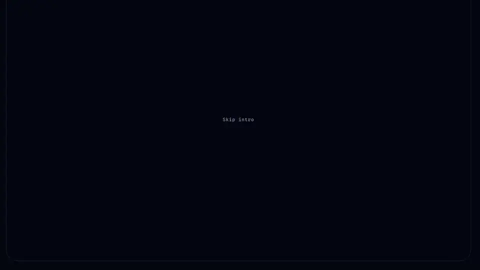
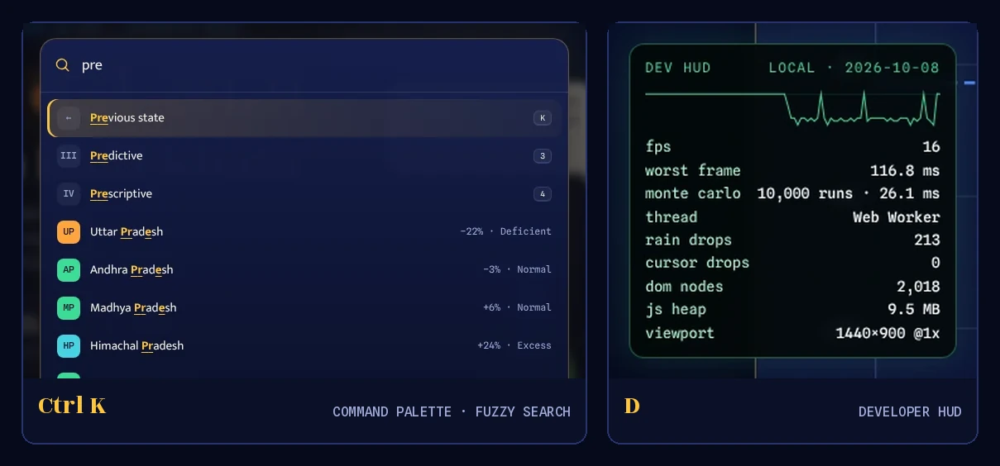
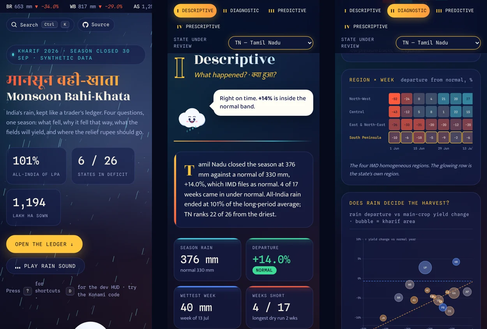

<div align="center">



### India's monsoon, kept like a trader's ledger.

A cinematic, fully client-side analytics engine that answers four questions about a season:<br>
**what fell, why it fell that way, what the harvest will be, and where the relief rupee should go.**

[](https://github.com/YOUR_GITHUB_USERNAME/monsoon-bahi-khata/actions/workflows/ci.yml)
[](https://github.com/YOUR_GITHUB_USERNAME/monsoon-bahi-khata/actions/workflows/deploy.yml)


**[Open the live demo →](https://YOUR_GITHUB_USERNAME.github.io/monsoon-bahi-khata/)**
&nbsp;·&nbsp; [Architecture](docs/ARCHITECTURE.md)
&nbsp;·&nbsp; [The maths](docs/MODELS.md)
&nbsp;·&nbsp; [Contributing](CONTRIBUTING.md)

<br>


<sub>The intro draws <b>मानसून</b> in gold · the cursor rains · <kbd>Ctrl</kbd> <kbd>K</kbd> → "g" → Gujarat · Megh cheers up and Mor starts dancing</sub>

</div>

<br>

## What it is

Data analytics is usually taught as four questions: **descriptive** (what happened?), **diagnostic** (why?), **predictive** (what next?) and **prescriptive** (what should we do?). This project answers all four for the 2026 south-west monsoon across 26 Indian states, on one page, with no server.

Pick a state on the map, in the ledger, on the scatter plot or with <kbd>Ctrl</kbd> <kbd>K</kbd>, and every section recomputes. The page fits a regression, runs 10,000 Monte Carlo harvests in a Web Worker and solves a constrained optimisation problem, all in your browser, in a few milliseconds.

Four hand-drawn characters react to the numbers as you go: **Megh** the cloud, **Mor** the peacock (he only dances when the rain was good), **Kisan** the farmer and **Munim ji** with his red bahi-khata.

<br>

## The four pillars


| Pillar                | Asks                          | Shows                                                                                                                                                                        |
| --------------------- | ----------------------------- | ---------------------------------------------------------------------------------------------------------------------------------------------------------------------------- |
| **I · Descriptive**   | क्या हुआ? What happened?      | Tile cartogram in IMD departure bands, weekly actual-vs-normal rain, sortable ledger of all 26 states with sparklines                                                        |
| **II · Diagnostic**   | ऐसा क्यों हुआ? Why?           | Waterfall splitting the departure into El Niño, the IOD, onset delay, the August break and local weather; region × week heatmap; rain-vs-yield scatter with the fitted model |
| **III · Predictive**  | आगे क्या होगा? What next?     | 10,000 seeded Monte Carlo harvests per scenario; drag October rain or change pest pressure and the distribution, p10–p90 band and loss probability move                      |
| **IV · Prescriptive** | क्या करें? What should we do? | An exact optimiser splits the relief budget across seven actions, and knows when to stop: money that would protect less than ₹1 per rupee goes back for another state        |

<div align="center">

<sub>Karnataka: drag October rain from +20 % to −45 % and set pests to high. Kisan's face falls as the loss tail turns red.</sub>
</div>

<br>

## Engineering highlights



**A pure, typed engine.** All the analytics live in [`src/engine/`](src/engine): strict TypeScript with `noUncheckedIndexedAccess`, no DOM, no globals and no `Math.random`. Randomness comes from a seeded Mulberry32 generator, so every number on the page is reproducible and testable.

**An exact optimiser, not a heuristic.** The relief budget problem has concave returns, so the optimum equalises marginal returns across funded actions (the KKT condition). The solver finds that point by geometric bisection on the Lagrange multiplier:

$$x_i^{*}(\lambda) = \frac{c_i}{r_i}\ln\frac{r_i}{\lambda}, \qquad \sum_i x_i^{*}(\lambda) = B$$

It's about **50× faster** than a greedy loop, and the tests check it against a 4,000-step greedy oracle on 25 random problems. A hurdle rate stops it from wasting money on actions that return less than they cost.

**Work off the main thread.** The Monte Carlo runs in a module Web Worker and hands back a transferable `Float64Array`. If a sandboxed frame blocks workers, the client falls back to the main thread in 1.5 s, so the forecast always renders.

**Fast first load.** Only the hero renders at boot. Each pillar is a dynamic `import()` that mounts when it nears the viewport, keeping initial JS to about **16 KB** gzipped. A custom Vite plugin preloads the critical fonts by their hashed names, which cut layout shift from 0.16 to 0.005.

| Lighthouse                         | Performance | Accessibility | Best practices |   SEO   |
| ---------------------------------- | :---------: | :-----------: | :------------: | :-----: |
| Desktop                            |   **99**    |    **100**    |    **100**     | **100** |
| Mobile (simulated slow 4G, 4× CPU) |     ~80     |    **100**    |    **100**     | **100** |

**Zero-dependency tests.** Node 22.18+ runs TypeScript natively, so the suite uses `node:test` with no test framework. CI runs lint, format check, typecheck, coverage, build and benchmarks on Node 22 and 24, then deploys to GitHub Pages.

More in [ARCHITECTURE.md](docs/ARCHITECTURE.md) and [MODELS.md](docs/MODELS.md).

<br>

## For the curious



<sub><b>Command palette</b> (<kbd>Ctrl</kbd> <kbd>K</kbd> or <kbd>/</kbd>): a dynamic-programming fuzzy matcher ranks states, sections and actions and highlights the letters that matched. <b>Developer HUD</b> (<kbd>D</kbd>): live FPS graph, worst frame, Monte Carlo time and thread, particle counts, DOM size, JS heap and the build's commit. This capture comes from a headless browser with software rendering, so its frame rate is far below what a real GPU gives.</sub>

| Key                                                                                                                      | Does                                                |
| ------------------------------------------------------------------------------------------------------------------------ | --------------------------------------------------- |
| <kbd>Ctrl</kbd> <kbd>K</kbd> · <kbd>/</kbd>                                                                              | Command palette                                     |
| <kbd>1</kbd> – <kbd>4</kbd>                                                                                              | Jump to a pillar                                    |
| <kbd>J</kbd> <kbd>K</kbd> · <kbd>←</kbd> <kbd>→</kbd>                                                                    | Next / previous state                               |
| <kbd>M</kbd>                                                                                                             | Rain sound, synthesised live with the Web Audio API |
| <kbd>D</kbd>                                                                                                             | Developer HUD                                       |
| <kbd>C</kbd>                                                                                                             | Copy a deep link (`?state=GJ`)                      |
| <kbd>R</kbd>                                                                                                             | Reset the scenario                                  |
| <kbd>?</kbd>                                                                                                             | All shortcuts                                       |
| <kbd>↑</kbd><kbd>↑</kbd><kbd>↓</kbd><kbd>↓</kbd><kbd>←</kbd><kbd>→</kbd><kbd>←</kbd><kbd>→</kbd><kbd>B</kbd><kbd>A</kbd> | Try it                                              |

<details>
<summary><b>What the Konami code does</b> (spoiler)</summary>
<br>

<sub>Cloudburst mode. The rain triples, lightning forks every second, the hero shakes and Megh shouts <i>"Badal phat gaya!"</i></sub>
</details>

<details>
<summary><b>On a phone</b></summary>
<br>

<sub>Single-column layout, no horizontal scroll, touch-friendly controls. The custom cursor switches itself off on touch screens.</sub>
</details>

<br>

## Built with

| Layer    | Tools                                                                                                        |
| -------- | ------------------------------------------------------------------------------------------------------------ |
| Engine   | TypeScript (strict), Mulberry32 PRNG, Box–Muller, closed-form OLS, Monte Carlo, KKT optimisation             |
| Charts   | D3.js v7 (cartogram, waterfall, heatmap, scatter, histogram), Chart.js 4 (tree-shaken)                       |
| Effects  | Canvas 2D sky and cursor, inline SVG characters, Web Audio API, CSS 3D transforms                            |
| Platform | Web Workers, Service Worker + manifest (installable, offline), IntersectionObserver, `Intl` en-IN formatting |
| Tooling  | Vite 7, ESLint 10 + typescript-eslint, Prettier, `node:test` with type stripping                             |
| Delivery | GitHub Actions (CI matrix, Pages deploy), Dependabot                                                         |

<br>

## Run it locally

```bash
git clone https://github.com/YOUR_GITHUB_USERNAME/monsoon-bahi-khata.git
cd monsoon-bahi-khata
npm ci
npm run dev
```

Needs Node 22.18 or newer.

| Script             | What it does                                  |
| ------------------ | --------------------------------------------- |
| `npm run dev`      | Dev server with hot reload                    |
| `npm run build`    | Production build into `dist/`                 |
| `npm run preview`  | Serve the production build                    |
| `npm test`         | Engine unit tests                             |
| `npm run coverage` | Tests with a coverage table                   |
| `npm run bench`    | Micro-benchmarks for the engine's hot paths   |
| `npm run check`    | Lint, typecheck, test and build: what CI runs |

<details>
<summary><b>Project structure</b></summary>

```text
monsoon-bahi-khata/
├── index.html                  page shell, palette, shortcuts sheet, HUD
├── src/
│   ├── engine/                 pure TypeScript, no DOM
│   │   ├── data.ts             26 states, crops, drivers, weekly shares
│   │   ├── random.ts           FNV-1a, Mulberry32, Box–Muller
│   │   ├── stats.ts            Pearson, OLS, quantiles
│   │   ├── imd.ts              IMD departure bands
│   │   ├── season.ts           weekly series that sum exactly
│   │   ├── diagnose.ts         driver decomposition, closest twin
│   │   ├── yield-model.ts      rain × rainfed-share regression
│   │   ├── montecarlo.ts       scenarios, simulation, summaries
│   │   ├── optimizer.ts        exact KKT allocation + greedy oracle
│   │   ├── relief.ts           interventions, risk, playbook
│   │   └── fuzzy.ts            DP fuzzy matcher
│   ├── workers/                Monte Carlo Web Worker
│   ├── sections/               hero + one module per pillar
│   ├── charts/                 D3 and Chart.js renderers
│   ├── ui/                     sky, cursor, palette, HUD, audio, router, PWA
│   ├── cartoons/               hand-drawn SVG characters
│   ├── styles/                 tokens and component CSS
│   ├── store.js                20-line observable store
│   └── main.js                 boot, lazy mounting, keyboard
├── tests/                      node:test suites
├── bench/                      engine benchmarks
├── public/                     manifest, service worker, icons, og image
├── docs/                       architecture, maths, README assets
└── .github/                    CI, Pages deploy, Dependabot, templates
```

</details>

<br>

## Deploy your own copy

1. Fork or push this repo to GitHub.
2. Run `npm run set-repo -- <your-github-username>` to point every link and badge at your account, then commit.
3. In **Settings → Pages**, set **Source** to **GitHub Actions**.
4. Push to `main`. The deploy workflow builds and publishes to `https://<you>.github.io/monsoon-bahi-khata/`.
5. Optional: upload [`docs/assets/social-preview.png`](docs/assets/social-preview.png) under **Settings → General → Social preview**.

<br>

## Roadmap

- [x] Four pillars, 26 states, seeded engine
- [x] Monte Carlo in a Web Worker
- [x] Exact budget optimiser with a hurdle rate
- [x] Command palette, HUD, deep links, offline support
- [ ] Load real IMD sub-division rainfall from a CSV the user drops on the page
- [ ] District-level drill-down
- [ ] Full Hindi interface toggle
- [ ] Optimise one budget across all states at once

<br>

## About the data

The season totals, crop areas, irrigation shares and prices are **synthetic**, chosen to be plausible, not observed. The IMD rainfall categories and the all-India long-period average of 868.6 mm (1971–2020) are real. Don't use these numbers for real decisions; use the engine and plug real data in.

<br>

<div align="center">

Built by **Namit Tiwari** · [MIT licence](LICENSE)

<sub>If this made you smile, a ⭐ helps other people find it.</sub>

</div>
