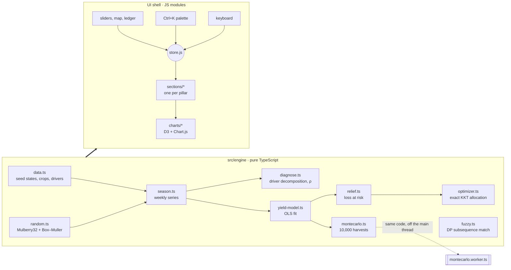
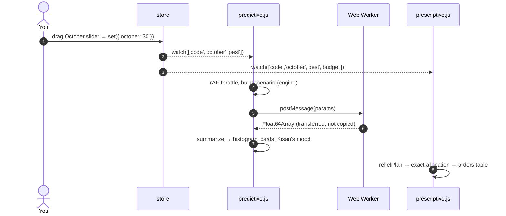

# Architecture

Monsoon Bahi-Khata is a static site with no backend. Every number on the page is computed in the browser, at load, from a few kilobytes of seed data.

The code follows one rule: **functional core, imperative shell.**

- **`src/engine/`** is the core. Pure TypeScript functions: no DOM, no globals, no clock, no `Math.random`. Given the same input they always return the same output, which is what makes them testable to 99.9 % line coverage.
- **Everything else** is the shell. Plain JavaScript modules that read the store, call the engine, and draw.

## Data flow

There is one store and data flows one way. Controls never touch the DOM of another section; they call `store.set()`, and every section that cares re-renders.

The store is twenty lines (`src/store.js`). `watch(keys, fn)` fires once on subscribe and then only when one of `keys` changes, so a budget drag never re-renders the rain map.

## Decisions worth explaining

### Deterministic everything

The season, the Monte Carlo draws and the screenshots in this README are reproducible because randomness comes from a seeded PRNG (`mulberry32`) keyed by a hash of the state code and scenario. Tests can assert exact values, two people looking at Bihar see the same histogram, and a bug report link (`?state=BR`) reproduces the same page.

### The Monte Carlo runs in a worker, with a fallback

`simulate()` is plain engine code. `montecarlo.worker.ts` imports it and runs it off the main thread, returning the result as a transferable `Float64Array` so 80 KB per run isn't copied.

Some sandboxed iframes refuse to start workers and fail silently. The first version of this project had exactly that bug: the Predictive section stayed blank. `mc-client.js` now falls back to the main thread if the worker errors or doesn't answer within 1.5 s. The developer HUD (press <kbd>D</kbd>) shows which thread the last run used.

### An exact optimiser, not a greedy one

The relief budget is split across seven actions, each with diminishing returns:

$$b_i(x) = c_i\left(1 - e^{-r_i x / c_i}\right)$$

The total is concave, so the optimum equalises marginal returns across funded actions (the KKT condition). That gives each spend in closed form for a given multiplier λ, and λ is found by bisection. See [MODELS.md](MODELS.md) for the derivation.

A greedy "hand out ₹1 at a time" loop gets close but costs O(steps × n). The exact solver is about 50× faster and provably optimal; the greedy version is kept in the code as a test oracle.

The solver also has a **hurdle rate**. Without one, a big budget gets poured into actions returning 0.3× just because the money is there. With `minReturn: 1`, it stops funding an action once the next rupee would protect less than a rupee, and reports the rest as unspent. That bug was caught by eye in a screenshot, then pinned with a test.

### Code-split sections, mounted on approach

Only the hero renders at load. Each pillar is a dynamic `import()` that fires when the section comes within 800 px of the viewport, so D3 and Chart.js aren't parsed until someone scrolls. Initial JS is about 16 KB gzipped.

### Layout stability

Lighthouse first measured a layout shift of 0.16. Two causes, two fixes:

1. Fonts were discovered late, after the CSS. A 25-line Vite plugin (`vite.config.ts`) injects `<link rel="preload">` for the two faces the first screen uses, with their content-hashed build names.
2. The ticker above the hero changed height when its monospace font arrived, pushing the whole page down. It now has a fixed height.

Layout shift dropped to 0.005.

### Tests without a test framework

Node 22.18+ runs TypeScript directly by stripping types, and ships a test runner and coverage. So the test suite has **zero dependencies**: `node --test tests/**/*.test.ts`. A framework was tried first, and its dependency tree carried security advisories that the built-in runner simply doesn't have.

## Module map

| Path                        | What it does                                                              |
| --------------------------- | ------------------------------------------------------------------------- |
| `src/engine/data.ts`        | Seed data: 26 states, crops, weekly shares, regional shifts, drivers      |
| `src/engine/random.ts`      | FNV-1a hash, Mulberry32 PRNG, Box–Muller normal                           |
| `src/engine/stats.ts`       | Sum, mean, Pearson ρ, closed-form OLS, quantiles                          |
| `src/engine/imd.ts`         | IMD departure bands with IMD's rounding                                   |
| `src/engine/season.ts`      | Expands season totals into 17 weekly values that sum exactly              |
| `src/engine/diagnose.ts`    | Splits a departure into global drivers and local weather                  |
| `src/engine/yield-model.ts` | Fits yield change on rain × rainfed share                                 |
| `src/engine/montecarlo.ts`  | Scenario builder, simulation, quantile summary                            |
| `src/engine/optimizer.ts`   | Exact KKT allocation with hurdle rate, greedy oracle                      |
| `src/engine/relief.ts`      | Interventions, loss at risk, dated playbook                               |
| `src/engine/fuzzy.ts`       | Dynamic-programming fuzzy matcher for the palette                         |
| `src/workers/`              | Monte Carlo worker                                                        |
| `src/store.js`              | Observable store                                                          |
| `src/sections/`             | One module per pillar plus the hero                                       |
| `src/charts/`               | Cartogram, weekly bars, waterfall, heatmap, scatter, histogram, sparkline |
| `src/ui/`                   | Sky, cursor, palette, HUD, audio, router, PWA, effects                    |
| `src/cartoons/`             | Hand-drawn SVG characters as strings                                      |
| `public/sw.js`              | Service worker: network-first shell, cache-first assets                   |
